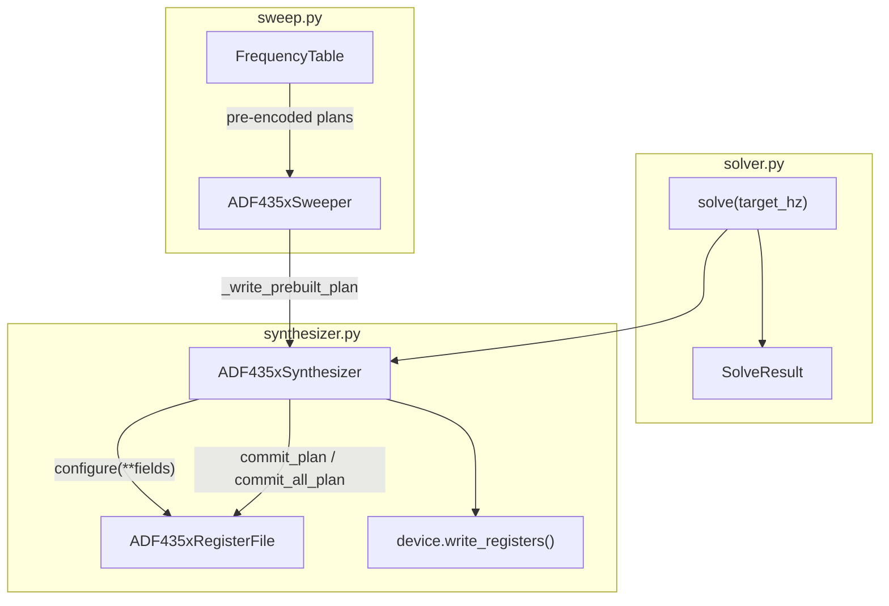

# Architecture

MicroPython library for Analog Devices ADF4350 and ADF4351 wideband PLL
synthesizers. Board-agnostic: runs on any MicroPython port with SPI and GPIO.
Pin assignment and SPI bus selection are the caller's responsibility.

## Portability

- All layers except [`device.py`](../adf435x/device.py) are pure Python with no
  `machine` import.
- [`ADF435xSynthesizer`](../adf435x/synthesizer.py) accepts a duck-typed device
  (`write_registers`, `chip_enable`, `chip_disable`, `read_muxout`) — not only
  [`ADF435xDevice`](../adf435x/device.py).
- Code in `adf435x/` avoids CPython-only stdlib and uses MicroPython-compatible
  patterns (`const` shim, `time.ticks_*` fallbacks).
- Examples and [`test_device_hw.py`](../tests/test_device_hw.py) use one
  maintainer pin map (WeAct RP2350B + ADF4351 eval); adjust pins for your board.
  See [HARDWARE.md](HARDWARE.md).

## Layer stack

Every layer except `device` is pure and host-testable. The package root is
host-safe: only `adf435x.device` imports `machine`.

| Layer | Module | Role |
|-------|--------|------|
| Constants | [`consts.py`](../adf435x/consts.py) | Bit layout, encodings, DBR indices |
| Profiles | [`profiles.py`](../adf435x/profiles.py) | ADF4350 vs ADF4351 capability gates |
| Config | [`config.py`](../adf435x/config.py) | Field schema only (no validation) |
| Mapper | [`register_mapper.py`](../adf435x/register_mapper.py) | Validate-at-setup / trust-at-encode |
| Register file | [`register_file.py`](../adf435x/register_file.py) | Staleness diff, DBR/DBB ordering, plan/mark |
| Solver | [`solver.py`](../adf435x/solver.py) | Pure Hz → PLL fields |
| Synthesizer | [`synthesizer.py`](../adf435x/synthesizer.py) | Frequency-first facade |
| Sweep | [`sweep.py`](../adf435x/sweep.py) | Precomputed `FrequencyTable` + `ADF435xSweeper` |
| Device | [`device.py`](../adf435x/device.py) | SPI/GPIO transport |

## Data flow

```text
solve(target_hz) → configure(**fields) → commit_plan() → device.write_registers()
```



## Three-layer API model

Users interact at three distinct levels:

1. **`ADF435xSynthesizer`** — set one frequency, lock detect, power control.
   Frequency-first; owns solve → configure → write sequence.

2. **`FrequencyTable`** — precompute SPI write plans for an ordered list or
   range of frequencies. Built via `from_range` or `from_frequencies`.

3. **`ADF435xSweeper`** — playback engine for a table. Auto-enables fast-hop
   mode (`double_buffer`, 6 ns LDP) on first step.

Do not collapse synthesizer and sweep into one class; they serve different
mental models (single retune vs sequence playback).

## Commit plans: when to use which

| Method | Use when | Typical contents |
|--------|----------|------------------|
| `commit_all_plan()` | `power_up()`, divider boundary, full reprogram | All six registers R5→R0 |
| `commit_plan()` | `set_frequency()` retune, partial field change | Stale registers only (+ forced R0 for DBR/DBB) |

Both return 32-bit words in **R5→R0** order without updating the last-written
cache. The synthesizer calls `mark_written()` after a successful device write.

Word list index in tests: `WORKED_WORDS[n]` is register **Rn** — reverse when
comparing to a full SPI sequence (see [GLOSSARY.md](GLOSSARY.md)).

## Public export surface

[`adf435x/__init__.py`](../adf435x/__init__.py) exports:

- `ADF435xConfig`, `ADF4350`, `ADF4351`, `ADF435xRegisterMapper`,
  `ADF435xRegisterFile`, `ADF435xSynthesizer`
- `solve`, `SolveOptions`, `SolveResult`, `DividerOctaveCrossingError`,
  `output_band_hz`, `max_hz_for_rf_divider`

**Not exported from package root** (import by submodule):

- `adf435x.sweep` — `FrequencyTable`, `ADF435xSweeper`
- `adf435x.device` — `ADF435xDevice` (requires `machine`)

## Key patterns

### Validate-at-setup / trust-at-encode

`register_mapper.validate_config()` runs when the register file is configured.
Encode masks field widths but does not re-check ranges on the hot path.

### Plan/mark split

`commit_plan()` returns words without updating the last-written cache.
The synthesizer calls `mark_written()` after a successful SPI write, or
`mark_write_failed()` on error.

### Staleness by diff

The register file compares encoded `_current` vs `_last_written`. No
hand-kept dirty flags.

### Duck-typed device

`ADF435xSynthesizer` expects `write_registers`, `chip_enable`, `chip_disable`,
and `read_muxout`. No hard dependency on `ADF435xDevice`.

### Sweep optimization

Within a divider band, the first frequency's MOD is locked so subsequent hops
change only INT/FRAC — enabling single R0 writes. Divider boundaries trigger
full R5→R0 writes.

## Examples

| Example | Purpose |
|---------|---------|
| [`fixed_frequency.py`](../examples/fixed_frequency.py) | Single frequency via synthesizer |
| [`fixed_frequency_solver.py`](../examples/fixed_frequency_solver.py) | Lower-level solver usage |
| [`frequency_sweep.py`](../examples/frequency_sweep.py) | Linear sweep via sweeper |
| [`frequency_sweep_octave.py`](../examples/frequency_sweep_octave.py) | Multi-band sweep with divider crossings |
| [`frequency_table_solver.py`](../examples/frequency_table_solver.py) | Table building |
| [`device_handler.py`](../examples/device_handler.py) | Raw SPI/device usage |
| [`registers.py`](../examples/registers.py) | Register-level example |

## Related docs

- [GLOSSARY.md](GLOSSARY.md) — naming conventions
- [DATASHEET.md](DATASHEET.md) — PLL facts and figure map
- [DESIGN_DECISIONS.md](DESIGN_DECISIONS.md) — invariants
